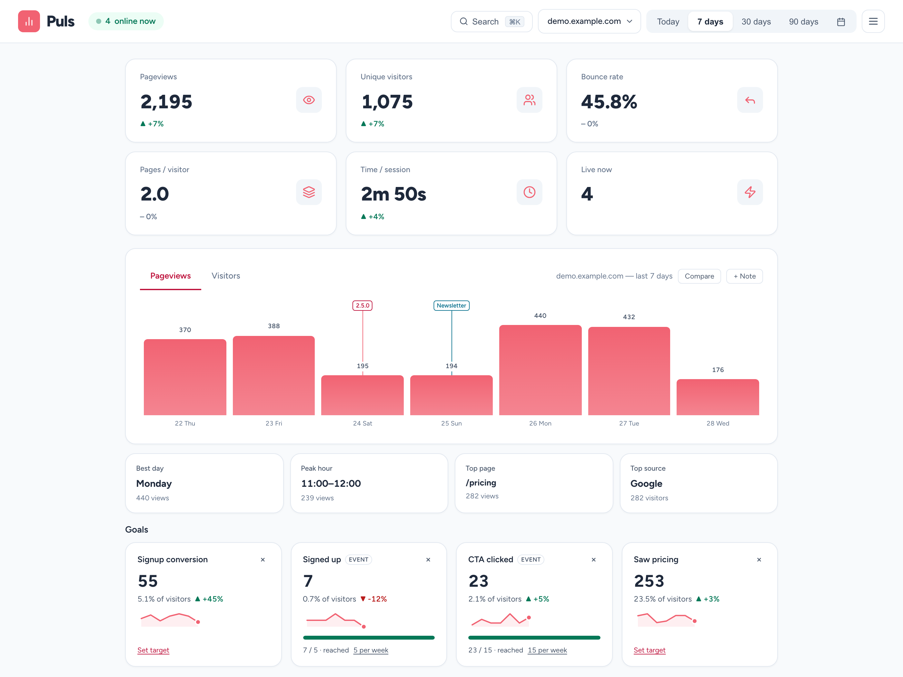
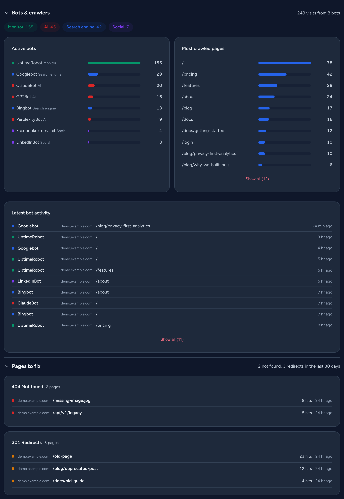
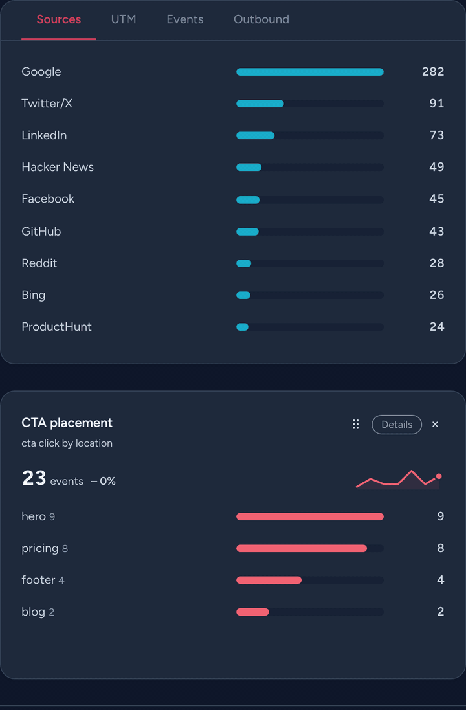
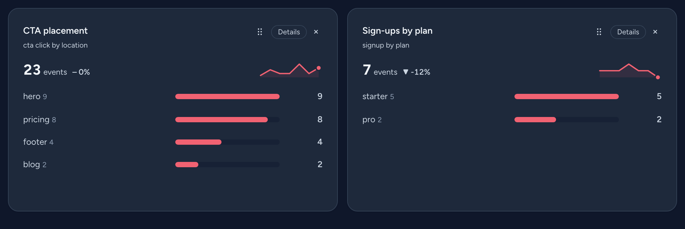
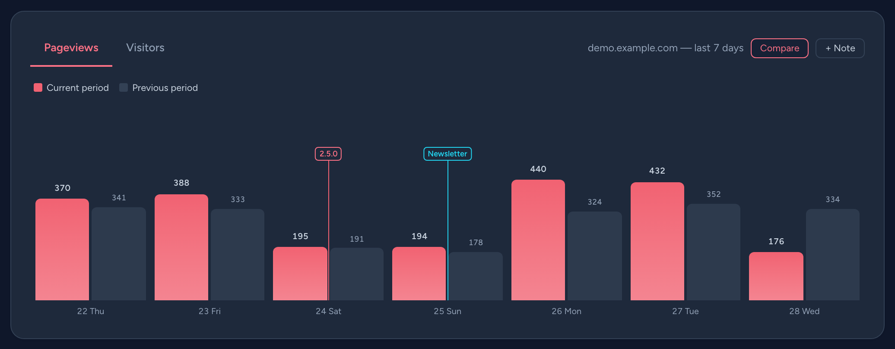
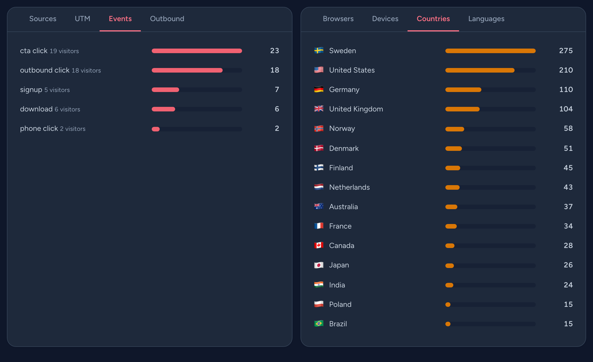

<div align="center">


# Puls

**One file. No cookies. Full picture.**

Self-hosted web analytics in a single PHP file and SQLite.<br>
Upload it to any PHP host and see your traffic in minutes, without a cookie banner.

[](https://github.com/webready-se/puls/actions/workflows/tests.yml)
[](https://github.com/webready-se/puls/releases/latest)
[](LICENSE)

</div>

<picture>
  <source media="(prefers-color-scheme: dark)" srcset="docs/screenshots/dashboard.png">
  
</picture>

## Get started in two minutes

On any host with PHP 8.3 or newer, download the [latest release](https://github.com/webready-se/puls/releases/latest), then:

```bash
unzip puls-*.zip && cd puls-*/
php puls user:add admin            # create your login
php -S localhost:8080 -t public    # try it, or point your web server at public/
```

Add one line to every site you want to track:

```html
<script src="https://stats.example.com/?js" data-site="example.com" defer></script>
```

That's it. Docker, Nginx, Laravel Forge and shared hosting without SSH are covered in [Install and run](docs/install.md).

## Why Puls

- **One file, no infrastructure.** A PHP file, a dashboard page and SQLite. No Node, no Docker, no database server, no build step. It runs on ordinary PHP web hosting.
- **Private by design.** No cookies and no stored IP addresses. A visitor is a hash with a random salt that is deleted after the day, so it can never be computed again, not even by whoever runs the server. Puls is designed to work without a consent banner.
- **Your data, on your server.** One SQLite file you can copy, back up or delete. MIT licensed, no limits, no account.
- **Light on your pages.** The tracking script is under 2 KB gzipped and sends with `sendBeacon`, so it never holds up the page.

## What you get

### See who reads your site besides people

Bots are counted apart from your visitors: AI crawlers such as GPTBot, ClaudeBot and PerplexityBot, search engines, SEO tools, social previews and uptime monitors, with the pages they read. Behind Nginx, Puls also logs 404s and redirects as **pages to fix**, with the pages that link to them. Both sections stay folded until you open them, and their headers say what is inside ("1,128 visits from 8 bots", "2 not found, 3 redirects"), so you can tell when one is worth a look.



### Events you can read, not just count

`puls.track('signup', { plan: 'pro' })` is all it takes. Each event gets a trend, a rate per 100 visitors, a breakdown by any key in its data, a two-step funnel and a CSV export. Save a breakdown and it becomes a card on the dashboard, with its total, its change and a sparkline.





### Goals with targets

A goal is a page or an event. Its tile shows the visitors who converted, their share of all visitors, the change against the previous period and, if you set one, a target such as 10 per week.

### And the rest

- **Traffic:** channels (paid, campaign, organic, social, referral, direct), UTM campaigns with a link builder, Google Ads detection, entry and exit pages, bounce rate and session length
- **Over time:** compare with the previous period, custom date ranges, chart notes for campaigns and mentions, release markers from your app version, a live visitor count
- **Teams and clients:** one dashboard for many sites, users limited to their own sites, read-only share links, a [JSON and CSV API](docs/api.md)
- **Tracking without code:** phone and email clicks, downloads, form submissions, outbound links
- **Keeping personal data out:** drop query strings or turn ids and tokens in URLs into `:id` and `:token` before anything leaves the browser
- **Everyday use:** dark mode, a ⌘K command palette, installable as an app, white-label branding, an interactive CLI

<details>
<summary>More screenshots</summary>

**Compare with the previous period**



**Events and countries**



**Light mode**


</details>

## How Puls compares

| | What you run | Database | Cookies | Hosted version | License |
|---|---|---|---|---|---|
| **Puls** | One PHP file on any PHP 8.3 host, or Docker | SQLite, built in | None | No | MIT |
| [GoatCounter](https://www.goatcounter.com) | One Go binary | SQLite or PostgreSQL | None | Free, donation-supported | EUPL (modified) |
| [Umami](https://umami.is) | Node.js app, or Docker | PostgreSQL | None | Free tier and paid plans | MIT |
| [Plausible CE](https://github.com/plausible/community-edition) | Docker Compose, 2 GB RAM recommended | PostgreSQL and ClickHouse | None | Paid | AGPL-3.0 |
| [Matomo](https://matomo.org) | PHP app | MySQL or MariaDB | Yes by default, can be turned off | Paid | GPL-3.0 |
| Google Analytics | Nothing, Google hosts it | Google's servers | Yes | Free | Proprietary |

<sub>From each project's own documentation, October 2026. Corrections are welcome as issues or pull requests.</sub>

**When to pick something else.** Puls is made for small and medium sites that you run yourself.

- You would rather not run anything: Plausible and Umami have hosted plans, and GoatCounter has a free hosted service.
- Millions of pageviews a month on one site: a database built for analytics, like Plausible's ClickHouse, stays fast at that size. Puls's dashboard slows down there; making it faster is [on the roadmap](ROADMAP.md).
- E-commerce reports, heatmaps or session recordings: Matomo does that, Puls doesn't.

## Privacy

- **No cookies**, ever
- **No IP addresses stored:** the visitor id is a hash of IP and user agent with a random salt that is deleted after the day
- **No fingerprinting:** no canvas, font or WebGL tricks
- **Collected:** page path, referrer domain, browser, device type, UTM parameters, language and country (from the `Accept-Language` header)
- **Kept:** pageviews until you delete them, custom events for 400 days (`EVENTS_RETENTION_DAYS`), bot visits for 90 days and broken links for 30 days after the last hit

You decide what your sites send. [Keeping personal data out of URLs](docs/integrations.md#keeping-personal-data-out-of-urls) shows how to drop search terms, ids and personal links before they reach Puls.

## Documentation

- [Install and run](docs/install.md): release download, shared hosting, Nginx, Apache, Laravel Forge, Docker, upgrading
- [Tracking and integrations](docs/integrations.md): script attributes, custom events, frameworks (Next.js, Astro, Laravel, Statamic, React), auto events, server-side bot tracking, reverse proxies
- [Configuration and CLI](docs/configuration.md): `.env` settings, users and access, share links, excluding your own visits, white-label, every CLI command
- [Read API](docs/api.md): JSON and CSV with a share token, also for [your AI assistant](docs/api.md#use-it-from-an-ai-assistant)
- [Changelog](CHANGELOG.md) and [roadmap](ROADMAP.md)

## License

MIT. Made by [Webready](https://webready.se) in Sweden. The dashboard uses the Figtree typeface, under the SIL Open Font License (`public/fonts/OFL.txt`).
